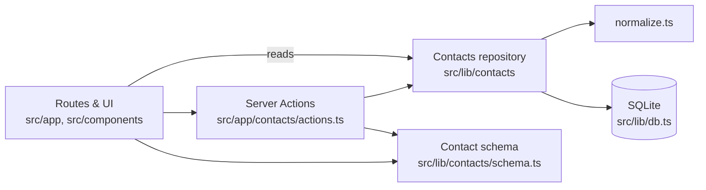
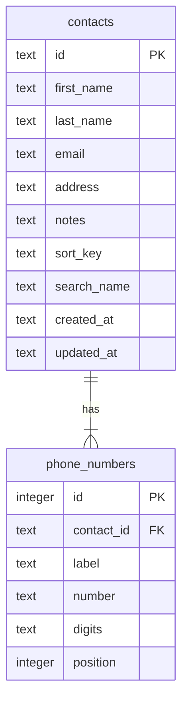

# Architecture Spine — Phone book

## Design Paradigm

**Server-first Next.js App Router, layered.** Pages are React Server Components that read through the contacts repository. Every write is a Server Action. Only the repository touches the database. Client Components exist only for interactivity: the search box, the Contact form, and the delete confirmation.

| Layer | Lives in | May depend on |
| --- | --- | --- |
| Routes & UI | `src/app/**`, `src/components/**` | actions, repository (reads only), schema |
| Server Actions | `src/app/contacts/actions.ts` | repository, schema |
| Contacts domain | `src/lib/contacts/**` (repository, schema, normalize) | db |
| Database | `src/lib/db.ts` | `better-sqlite3` |



## Invariants & Rules

### AD-1 — One repository owns all Contact data

- **Binds:** FR-1, FR-4, FR-5, FR-7, FR-8, FR-11, FR-12, FR-13, FR-14
- **Prevents:** one epic writing SQL in a page while another writes it in an action, so search keys and sort keys drift
- **Rule:** only `src/lib/contacts/repository.ts` runs SQL against `contacts` and `phone_numbers`. It exports typed functions (`listContacts(query?)`, `getContact(id)`, `createContact(input)`, `updateContact(id, input)`, `deleteContact(id)`, `findContactsByPhoneDigits(digits, excludeId?)`). Nothing else imports `src/lib/db.ts`.

### AD-2 — Writes go through Server Actions validated by one shared schema

- **Binds:** FR-7, FR-8, FR-9, FR-10, FR-13, FR-14
- **Prevents:** add and edit validating differently, or the client accepting what the server refuses
- **Rule:** create, update and delete are Server Actions in `src/app/contacts/actions.ts`. Each parses its input with `contactInputSchema` (Zod) from `src/lib/contacts/schema.ts`, the only definition of the PRD's FR-10 rules. The form may also use it on the client, but the server always re-validates. Actions are used with `useActionState`. On failure they return `ActionResult = { ok: false; fieldErrors?: Record<string, string>; formError?: string; duplicate?: { contactId: string; name: string }; values: ContactInput }`, echoing `values` so the form keeps what was typed. They never throw to the UI. On success they call `revalidatePath('/')` and `redirect()`: to `/contacts/[id]` after create or update, and to `/` after delete. Create and update first check `findContactsByPhoneDigits`. If they find a match and the submitted form lacks `allowDuplicate=true`, they return `duplicate` instead of saving, and the form offers "Save anyway" (FR-11).

### AD-3 — Search and sort keys are derived on write, in one place

- **Binds:** FR-1, FR-4, FR-5, FR-6, FR-11
- **Prevents:** search matching "José" in one query and not another, or "(555) 012" matching here but not in the duplicate check
- **Rule:** `src/lib/contacts/normalize.ts` exports `phoneDigits(s)` (digits only, `+` dropped) and `textKey(s)` (NFD, diacritics stripped, lower-cased, trimmed). The repository stores `sort_key`, `search_name` and each phone's `digits` on every write, and queries only those columns. Search is `search_name LIKE %textKey(q)%` OR (when `phoneDigits(q)` is non-empty) `digits LIKE %phoneDigits(q)%`. Ordering is always `ORDER BY sort_key, id`.

### AD-4 — Search state lives in the URL

- **Binds:** FR-4, FR-6
- **Prevents:** the list page and the search box each keeping their own copy of the query
- **Rule:** the Contact list page `/` reads `searchParams.q` and renders the filtered list on the server. The search box is a Client Component that replaces `?q=` with a 200 ms debounce (`router.replace`, no history entry per keystroke). An empty `q` removes the parameter.

### AD-5 — Contact identity and routes

- **Binds:** FR-1, FR-7, FR-8, FR-12, FR-13
- **Prevents:** links built in different shapes, or ids that change
- **Rule:** a Contact's id is a `crypto.randomUUID()` string assigned by the repository. The routes are `/` (Contact list), `/contacts/new`, `/contacts/[id]` (Contact details) and `/contacts/[id]/edit`. An unknown id calls `notFound()`, served by `src/app/contacts/[id]/not-found.tsx`.

### AD-6 — Single Node server with a SQLite file

- **Binds:** FR-14, NFR privacy
- **Prevents:** a serverless deployment that loses the database file, or a second store appearing
- **Rule:** SQLite through `better-sqlite3` (synchronous, server only). The file path comes from `DATABASE_PATH` (default `./data/phonebook.db`), and `data/` is git-ignored. `src/lib/db.ts` opens one shared connection, sets `journal_mode = WAL` and `foreign_keys = ON`, and applies the schema idempotently on first open (`CREATE TABLE IF NOT EXISTS …`). Tests use `DATABASE_PATH=:memory:`. The app runs as `next start` on a host with a persistent disk. No third-party services and no analytics.

## Consistency Conventions

| Concern | Convention |
| --- | --- |
| Naming | Domain terms from the PRD Glossary: `Contact`, `PhoneNumber`, `label`. Components are PascalCase files in `src/components/` (`ContactForm.tsx`, `ContactList.tsx`, `SearchBox.tsx`). DB columns are snake_case; TypeScript uses camelCase, mapped in the repository. |
| Labels | `type PhoneLabel = 'mobile' \| 'home' \| 'work' \| 'other'`, displayed as Mobile, Home, Work, Other. The default is `mobile`. |
| Dates | `created_at` and `updated_at` are ISO-8601 UTC strings, set by the repository. |
| Errors | User-facing messages come only from `ActionResult`. Unexpected errors are logged with `console.error` on the server, and the UI shows the `formError` "Could not save. Try again." with the form values kept (FR-14). |
| Styling | Tailwind CSS utility classes, mobile-first. No component library. |
| Accessibility | Every input has a `<label>`. Field errors use `aria-describedby`, and the error summary is `role="alert"`. Interactive elements are native `button` or `a`. |
| Testing | Vitest unit tests live beside their source as `*.test.ts`, covering normalize, schema and the repository against `:memory:`. Playwright e2e tests in `e2e/` cover each user journey. |
| Commands | `pnpm dev`, `pnpm build`, `pnpm lint`, `pnpm typecheck` (`tsc --noEmit`), `pnpm test` (Vitest), `pnpm e2e` (Playwright). |

## Stack

| Name | Version |
| --- | --- |
| Node.js | 24 LTS |
| pnpm | 10+ |
| Next.js (App Router) | 16.x |
| React | 19.x |
| TypeScript | the version `create-next-app@16` pins `[ASSUMPTION]` |
| Tailwind CSS | 4.x |
| better-sqlite3 | 12.x or later (13.x is current) |
| Zod | 4.x |
| Vitest | current major |
| Playwright | 1.x |

## Structural Seed



`phone_numbers.contact_id` references `contacts.id` with `ON DELETE CASCADE`. `position` keeps the order the owner entered, and the first Phone number has position 0. `sort_key` = `textKey(last_name || first_name) + ' ' + textKey(first_name)`.

```text
src/
  app/
    layout.tsx, page.tsx          # Contact list + search (FR-1..6)
    contacts/
      actions.ts                  # Server Actions (AD-2)
      new/page.tsx                # add (FR-7)
      [id]/page.tsx, not-found.tsx, edit/page.tsx   # details, edit (FR-8, FR-12)
  components/                     # ContactList, SearchBox, ContactForm, DeleteContactButton
  lib/
    db.ts                         # connection + schema (AD-6)
    contacts/ repository.ts, schema.ts, normalize.ts, types.ts
e2e/                              # Playwright journeys
data/                             # SQLite file, git-ignored
```

## Capability → Architecture Map

| Capability / Area | Lives in | Governed by |
| --- | --- | --- |
| FR-1, FR-2, FR-3 Contact list | `src/app/page.tsx`, `ContactList` | AD-1, AD-3, AD-5 |
| FR-4, FR-5, FR-6 Search | `SearchBox`, `listContacts(q)` | AD-3, AD-4 |
| FR-7, FR-8, FR-9, FR-10 Add / edit | `ContactForm`, `actions.ts`, `schema.ts` | AD-2, AD-5 |
| FR-11 Duplicate warning | `findContactsByPhoneDigits`, `ActionResult.duplicate` | AD-2, AD-3 |
| FR-12, FR-13 Details / delete | `src/app/contacts/[id]`, `DeleteContactButton` | AD-2, AD-5 |
| FR-14 Durable data | `src/lib/db.ts`, repository | AD-1, AD-6 |

## Deferred

- **Sign-in and access control:** v1 is private, per PRD Open Question 1. AD-1 keeps every read in one module, so an owner check can be added there later.
- **Hosting provider:** any host with a persistent disk running Node works (AD-6). The choice can wait until someone asks for a deployment.
- **Pagination or virtualised list:** at the 2,000-Contact target a server-rendered list is enough. Revisit if FR-3's 1 s budget is missed.
- **Country formatting of Phone numbers:** PRD Open Question 2. Numbers are displayed as typed.
- **Migrations tool:** the idempotent schema in `db.ts` covers v1. Add a migration tool at the first schema change after data exists.
